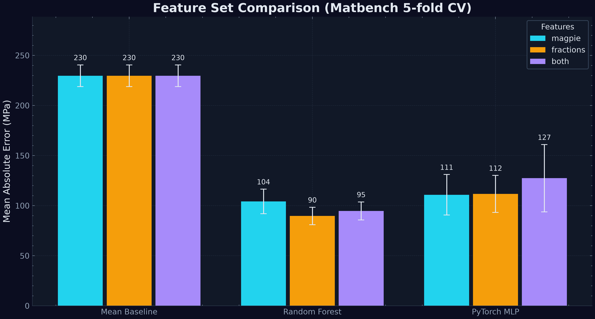
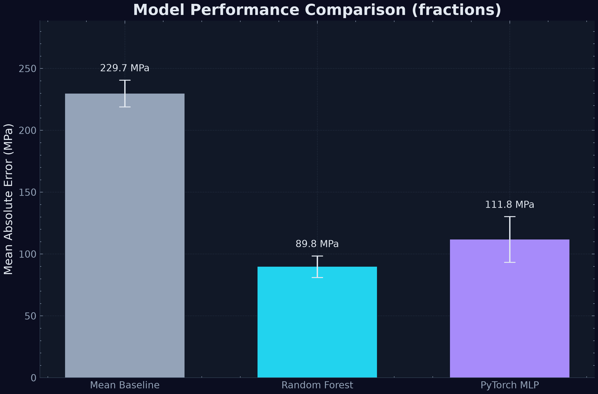
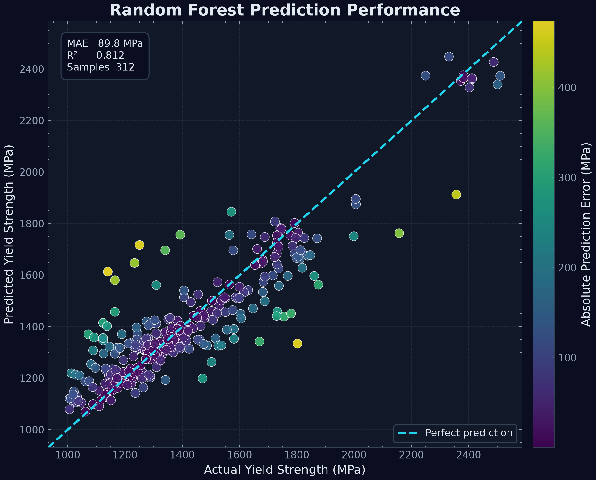
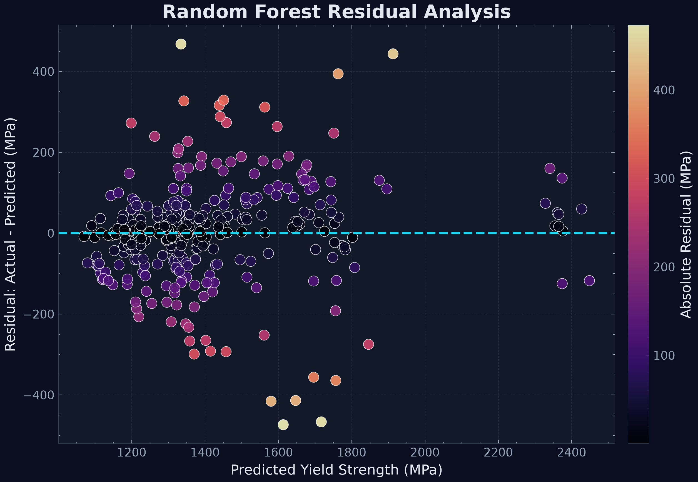
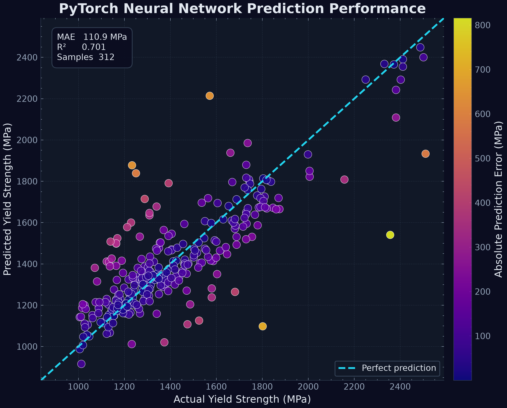
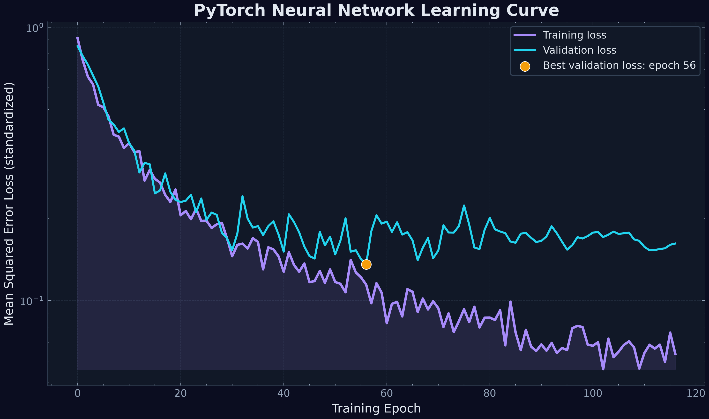
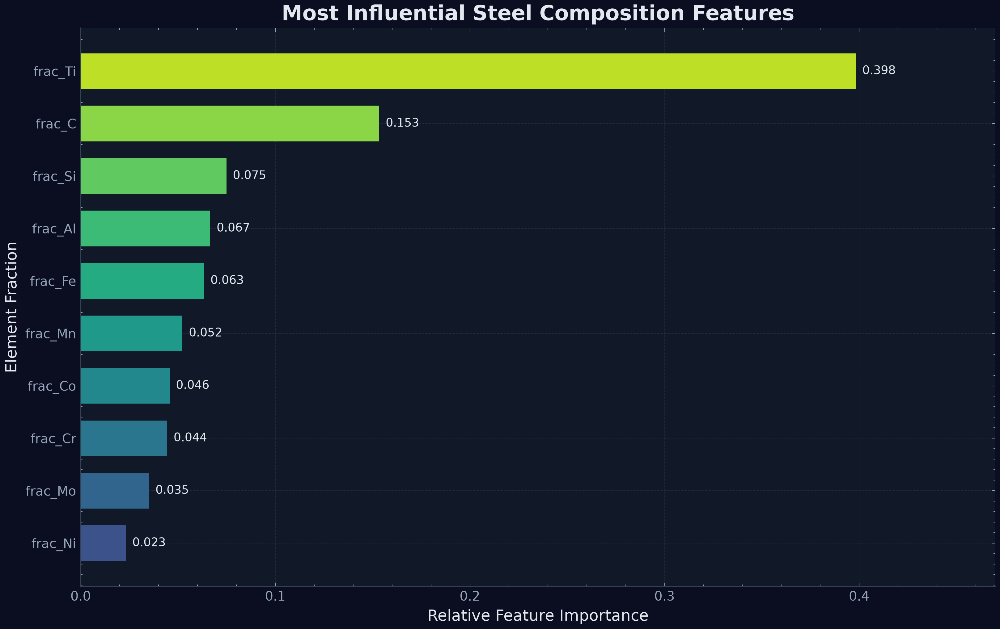
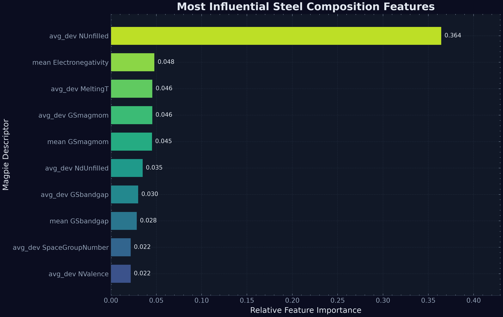

# Steel-ML: Yield Strength Prediction from Composition

Machine-learning models that predict the **yield strength of steels from their chemical
composition**, benchmarked on the [Matbench](https://matbench.materialsproject.org/)
`matbench_steels` dataset (312 alloys, yield strength in MPa).

This is phase 1 of a project on uncertainty-aware ML for alloy design. It sets up a
reproducible baseline: composition featurization, three models, and evaluation with the
official Matbench 5-fold protocol. Uncertainty quantification and active learning are
planned as later phases.

## What's inside

- **Featurization.** Composition strings are turned into model inputs in three ways:
  - `magpie`: 132 Magpie elemental-property statistics from matminer (means, ranges and
    deviations of atomic number, electronegativity, melting point and similar properties).
  - `fractions`: the atomic fraction of each of the 14 elements present in the dataset.
  - `both`: the two sets concatenated (146 features).
- **Models.**
  - **Mean baseline.** Predicts the training-set mean. Any useful model has to beat it.
  - **Random forest.** scikit-learn, 500 trees.
  - **PyTorch MLP.** Inputs and target are standardized and the net is trained on
    DataLoader mini-batches. An inner 10% validation split drives early stopping, which
    restores the best weights. The optimizer is AdamW with weight decay, plus dropout and
    a ReduceLROnPlateau learning-rate schedule.
- **Evaluation.** The official Matbench folds, `KFold(n_splits=5, shuffle=True,
  random_state=18012019)`, applied to the dataset in its published order. Each fold
  reports MAE, RMSE, R² and MAE/MAD, then they are averaged. Every scaler is fit on
  training-fold data only.

## Installation

Requires Python 3.10+ (developed on 3.12).

```bash
python -m venv .venv
# Windows: .venv\Scripts\activate     macOS/Linux: source .venv/bin/activate
pip install -r requirements.txt
pip install -e .
```

## Usage

Run the full benchmark (3 feature sets × 3 models × 5 folds, about a minute on a CPU):

```bash
python scripts/benchmark.py
```

The dataset is downloaded to `data/` on first run, and featurized matrices are cached in
`data/cache/`. Results go to `results/` and figures to `figures/`.

```bash
python scripts/benchmark.py --feature-sets fractions   # one feature set
python scripts/benchmark.py --quick                     # fewer trees/epochs, smoke test
```

Run the tests:

```bash
pytest
```

Use the package directly:

```python
from steel_ml.data import load_features
from steel_ml.evaluation import cross_validate
from steel_ml.models import make_random_forest

X, y = load_features("both")
result = cross_validate(make_random_forest, X, y)
print(result.per_fold)
print(result.summary())
```

## Repository structure

```
Steel-ML-Model/
├── src/steel_ml/
│   ├── data.py           # dataset loading, Magpie + element-fraction features, caching
│   ├── evaluation.py     # Matbench folds, metrics, cross_validate()
│   ├── plotting.py       # dark-themed parity, residual, importance, learning-curve plots
│   └── models/
│       ├── baselines.py  # MeanBaseline, make_random_forest()
│       └── mlp.py        # TorchMLPRegressor (scikit-learn style fit/predict)
├── scripts/benchmark.py  # end-to-end benchmark → results/ and figures/
├── tests/                # pytest unit tests
├── results/              # summary.md / .csv, per-fold metrics
├── figures/              # generated figures
├── requirements.txt
└── pyproject.toml
```

## Results

Matbench 5-fold cross-validation, mean ± standard deviation across folds. MAE/MAD is
computed against the mean absolute deviation of the full dataset, as on the Matbench
leaderboard. A value of 1.0 means no better than predicting the mean; lower is better.

| Features | Model | MAE (MPa) | RMSE (MPa) | R² | MAE/MAD |
| --- | --- | --- | --- | --- | --- |
| magpie | Mean Baseline | 229.7 ± 10.8 | 301.2 ± 24.0 | -0.009 ± 0.006 | 1.002 ± 0.047 |
| magpie | Random Forest | 104.3 ± 12.3 | 150.8 ± 30.6 | 0.737 ± 0.115 | 0.455 ± 0.053 |
| magpie | PyTorch MLP | 110.9 ± 20.2 | 159.7 ± 36.3 | 0.701 ± 0.133 | 0.484 ± 0.088 |
| fractions | Mean Baseline | 229.7 ± 10.8 | 301.2 ± 24.0 | -0.009 ± 0.006 | 1.002 ± 0.047 |
| fractions | Random Forest | **89.8 ± 8.7** | **128.5 ± 12.1** | **0.812 ± 0.047** | **0.391 ± 0.038** |
| fractions | PyTorch MLP | 111.8 ± 18.5 | 180.7 ± 62.3 | 0.591 ± 0.327 | 0.487 ± 0.080 |
| both | Mean Baseline | 229.7 ± 10.8 | 301.2 ± 24.0 | -0.009 ± 0.006 | 1.002 ± 0.047 |
| both | Random Forest | 94.8 ± 9.0 | 140.4 ± 22.9 | 0.774 ± 0.082 | 0.413 ± 0.039 |
| both | PyTorch MLP | 127.5 ± 33.6 | 190.9 ± 61.6 | 0.553 ± 0.284 | 0.556 ± 0.146 |

Per-fold numbers are in [results/per_fold_metrics.md](results/per_fold_metrics.md).

**Observations**

- The random forest on Magpie features (104.3 MPa) is close to the published Matbench
  "RF-SCM/Magpie" entry (about 103.5 MPa). This supports that the folds and pipeline
  reproduce the official protocol.
- Plain element fractions beat the Magpie descriptors for both tree-based models here.
  Almost every sample is an iron-based alloy, so averaged elemental properties blur the
  small alloying additions that drive strength. The fractions represent those additions
  directly.
- The MLP is competitive on Magpie features but varies much more between folds (fold 1 is
  consistently the hardest). With roughly 225 training samples per fold, its early-stopping
  validation set has only about 25 alloys, so model selection is noisy. This is part of the
  motivation for the uncertainty-aware models planned for the next phase.
- Titanium and carbon fractions are the most important random-forest features. That is
  consistent with the high-strength maraging and precipitation-hardened steels in the dataset.

### Figures

All parity and residual plots use **out-of-fold** predictions: each point is predicted by
a model that never saw it in training.

| | |
| --- | --- |
|  |  |
|  |  |
|  |  |
|  |  |

`figures/` holds the full set for every feature set.

## Roadmap

- [x] Phase 1: package structure, baselines, improved MLP, Matbench evaluation
- [ ] Phase 2: uncertainty quantification
- [ ] Phase 3: active learning for alloy design

## Data

Dataset: `matbench_steels` from Matbench v0.1, via matminer. Original data from
Citrine Informatics. See Dunn et al., *npj Computational Materials* 6, 138 (2020).
